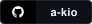
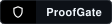
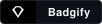

  <picture>
    <source media="(prefers-color-scheme: dark)" srcset="https://raw.githubusercontent.com/a-kio/a-kio/main/assets/header-dark.png?v=8">
    <source media="(prefers-color-scheme: light)" srcset="https://raw.githubusercontent.com/a-kio/a-kio/main/assets/header-light.png?v=8">
    
  </picture>

  

    
    
    
    
    
  

