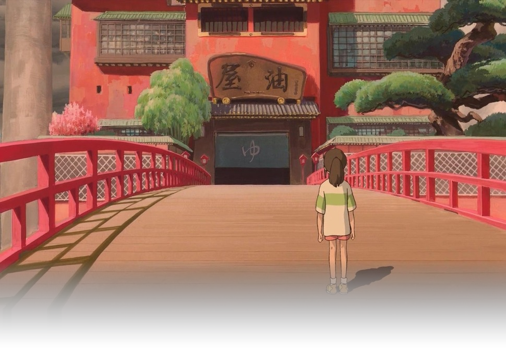

  <picture>
    <source media="(prefers-color-scheme: dark)" srcset="https://raw.githubusercontent.com/a-kio/a-kio/main/assets/header-dark.png?v=8">
    <source media="(prefers-color-scheme: light)" srcset="https://raw.githubusercontent.com/a-kio/a-kio/main/assets/header-light.png?v=8">
    
  </picture>

  

    
    
    
    
    
  

---

### ✦ About Me

I'm a systems engineer and developer tooling author passionate about **deterministic verification, agentic workflows, and pixel-perfect developer infrastructure**.

- 🛡️ **Building:** [ProofGate](https://github.com/a-kio/ProofGate) — Independent verification engine for AI coding agents. Cryptographically manifested evidence gates that eliminate hallucinations and false greens.
- 💎 **Crafting:** [Badgify](https://github.com/a-kio/Badgify) — High-end, aesthetic SVG badge generator with precision CJK typography, 270+ vector icons, and zero telemetry.
- ⚡ **Focus:** Verifiable computation, runtime internals, compiler optics, and high-performance TypeScript & Rust systems.
- 🌐 **Connect:** Follow engineering updates on [X (@akio_itw)](https://x.com/akio_itw).

---

### 🛡️ Flagship Projects

<table>
  <tr>
    <td width="50%" valign="top">
      <h3 align="center"><a href="https://github.com/a-kio/ProofGate">🛡️ ProofGate</a></h3>
      
<strong>AI wrote it. Prove it works.</strong>

      
Independent verification for AI coding agents. Real commands. Cryptographic hash-manifested evidence. Eliminates false greens and silent failures in automated coding loops.

      

        
        
      

    </td>
    <td width="50%" valign="top">
      <h3 align="center"><a href="https://github.com/a-kio/Badgify">💎 Badgify</a></h3>
      
<strong>Aesthetic SVG badges for modern developers.</strong>

      
Zero external network latency. Pure vector SVGs with balanced optical typography, 270+ vector icons, full CJK Japanese/Chinese support, and modern split/solid geometries.

      

        
        
      

    </td>
  </tr>
</table>

---

### 🛠️ Core Tech Stack

  
  
  
  
  
  
  
  
  

---

### 🎨 Favorite Anime Studios

  
  
  
  
  
  
  
  
  
  

---

### 🌐 Connect & Social

  
  
  

---

### 🏆 GitHub Achievements

  
  
  
  
  

---

### 📊 GitHub Activity & Metrics

  
  

 

  ⭐ If you build with agentic AI systems, check out <b><a href="https://github.com/a-kio/ProofGate">ProofGate</a></b> and design clean badges with <b><a href="https://github.com/a-kio/Badgify">Badgify</a></b>!

